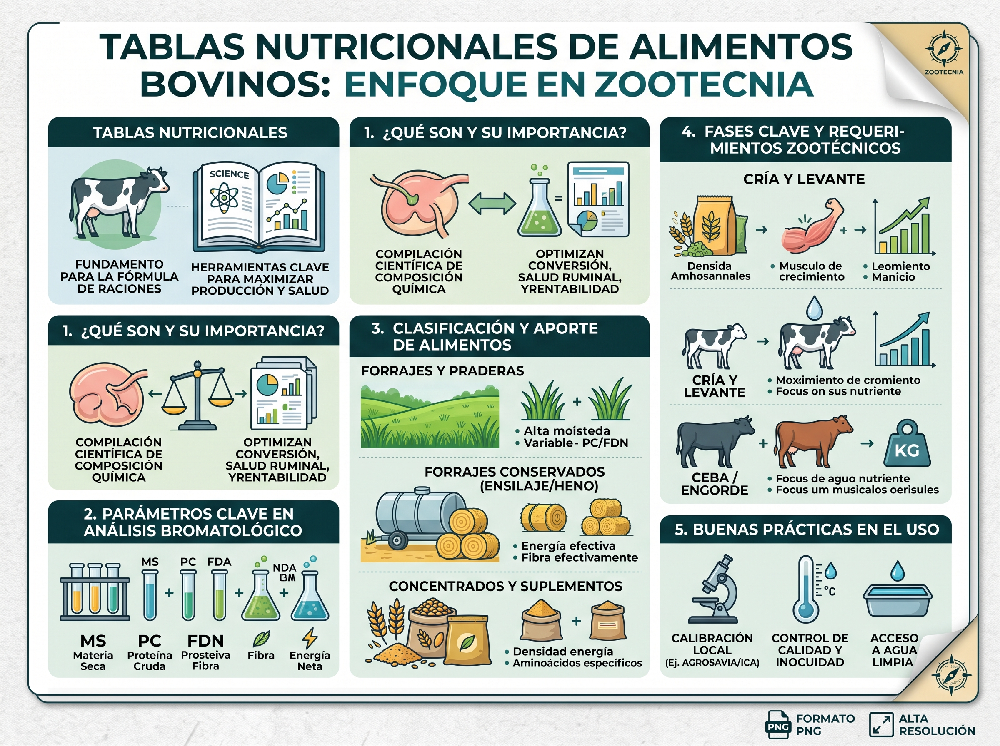

# 🐄 NutriBovino Pro: Experto en Nutrición Bovina y Zootecnia

<p align="center">
  
  
  
  
  
  
  
</p>

---
# Enlace: https://sebasga1309-alt.github.io/nutribovinos-pro/

## 📌 Descripción General

**NutriBovino Pro** es una habilidad (*Skill*) especializada de Inteligencia Artificial diseñada para convertir modelos de lenguaje (como **Google Gemini**) en un **consultor técnico de alto nivel en Zootecnia, Nutrición Animal y Alimentación de Rumiantes**.

Con un enfoque riguroso y adaptado tanto a **sistemas tropicales** como **templados**, esta herramienta facilita la interpretación de análisis bromatológicos, el cálculo de balances nutricionales, la formulación de raciones y la detección temprana de desórdenes metabólicos en bovinos de carne (ceba), leche y doble propósito.

---

## 🖼️ Infografía del Proyecto

A continuación se presenta la síntesis visual sobre el uso de tablas nutricionales y parámetros bromatológicos clave incluidos en este repositorio:

<p align="center">
  
</p>

> 📹 **Recurso Multimedia Adicional:** El repositorio incluye el video [`Cattle_moving_on_ranch_1080p_20261015133733.mp4`](./Cattle_moving_on_ranch_1080p_20261015133733.mp4) con tomas en alta definición (1080p) sobre manejo de ganado en pastoreo rotacional.

---

## 📑 Tabla de Contenidos

1. [Características Principales](#-características-principales)
2. [Estructura del Repositorio](#-estructura-del-repositorio)
3. [Instrucciones de Uso (System Prompt)](#-instrucciones-de-uso-system-prompt)
4. [Parámetros Bromatológicos Clave](#-parámetros-bromatológicos-clave)
5. [Ejemplos de Interacción](#-ejemplos-de-interacción)
6. [Estándares y Tablas de Referencia](#-estándares-y-tablas-de-referencia)
7. [Licencia y Créditos](#-licencia-y-créditos)

---

## 🚀 Características Principales

* **🔬 Interpretación Bromatológica Integral:** Análisis fisiológico y zootécnico de parámetros de laboratorio (Materia Seca, Proteína Cruda, FDN, FDA, NDT, Cenizas, etc.).
* **🌱 Evaluación de Insumos Tropicales y Templados:** Comparación y clasificación de pasturas (*Brachiaria, Kikuyo, Ryegrass*), ensilajes (maíz, sorgo), henos y subproductos agroindustriales.
* **⚖️ Optimización y Balanceo de Raciones:** Modelación paso a paso de requerimientos nutricionales para cría, levante, ceba/engorde y producción láctea.
* **⚠️ Detección y Alertas Metabólicas:** Identificación preventiva de acidosis ruminal subaguda (SARA), desbalance de nitrógeno amoniacal/energía fermentable y déficit de fibra efectiva ($FDN_{e}$).
* **📐 Formato Científico Estricto:** Fórmulas, ecuaciones de consumo y balances presentados con notación matemática **LaTeX** (`$`).

---

## 📂 Estructura del Repositorio

```text
📁 trabajo nuevo garo/
├── 🌐 index.html                                        # Landing Page interactiva de nutrición bovina
├── 🎨 styles.css                                        # Sistema de diseño, glassmorphism y tema agro-tecnológico
├── ⚡ app.js                                             # Lógica interactiva: calculadora de raciones, visor y generador IA
├── 📄 README.md                                         # Documentación técnica con badges y guía de uso
├── 📄 skill_zootecnia_nutrici_n_bovina.md              # Definición de la Skill y System Prompt para Gemini
├── 🖼️ Gemini_Generated_Image_ttvbf9ttvbf9ttvb.jpg        # Infografía en alta resolución: Tablas Nutricionales
└── 🎥 Cattle_moving_on_ranch_1080p_20261015133733.mp4  # Video de ganado bovino en pastoreo de campo
```

---

## 🛠️ Instrucciones de Uso (System Prompt)

Para utilizar esta skill en **Google Gemini**, **Gemini Studio**, **ChatGPT** o cualquier interfaz de LLM:

1. Abre una nueva conversación o crea un **Gemini Custom Gem** / **Custom GPT**.
2. Asigna el rol copiando y pegando el siguiente **System Prompt** documentado en [`skill_zootecnia_nutrici_n_bovina.md`](./skill_zootecnia_nutrici_n_bovina.md):

```markdown
"Actúa como un Zootecnista experto en nutrición y alimentación de rumiantes con más de 15 años de experiencia en campo y academia. Tu objetivo es asesorar a profesionales, estudiantes y productores en la interpretación de tablas nutricionales de alimentos bovinos, el diagnóstico bromatológico, el cálculo de requerimientos nutricionales y la formulación de dietas óptimas. 

Reglas de Operación:
1. Rigor Técnico: Utiliza terminología zootécnica precisa (Materia Seca, Proteína Cruda, FDN, FDA, NDT, Energía Metabolizable, Fibra Efectiva).
2. Contexto Tropical y Templado: Considera las variaciones de los forrajes según su estado fenológico y zona agroecológica.
3. Formato Científico: Utiliza exclusivamente sintaxis LaTeX ($) para todas las fórmulas, unidades o variables científicas (ej. $CMS$, $NDT$, $EN_l$).
4. Enfoque Práctico: Conecta siempre el valor analítico del alimento con el impacto zootécnico real (ganancia de peso, producción de leche, salud ruminal, conversión alimenticia)."
```

---

## 📊 Parámetros Bromatológicos Clave

| Parámetro | Sigla | Impacto Zootécnico Principal | Notación LaTeX |
| :--- | :---: | :--- | :---: |
| **Materia Seca** | $MS$ | Base de cálculo real del consumo e ingestión de nutrientes | `$MS (\%)$` |
| **Proteína Cruda** | $PC$ | Aporte nitrogenado total ($N \times 6.25$) | `$PC (\%)$` |
| **Fibra Detergente Neutro** | $FDN$ | Factor limitante del consumo voluntario por llenado ruminal | `$FDN (\%)$` |
| **Fibra Detergente Ácido** | $FDA$ | Fracción lignocelulósica; indicador inverso de digestibilidad | `$FDA (\%)$` |
| **Nutrientes Digestibles Totales** | $NDT$ | Estimador energético general de la ración | `$NDT (\%)$` |
| **Energía Neta de Lactancia** | $EN_l$ | Requerimiento energético para producción y mantenimiento | `$EN_l\ (Mcal/kg)$` |
| **Fibra Efectiva** | $FDN_e$ | Estimulación de rumia y mantenimiento del pH ruminal ($> 6.0$) | `$FDN_e (\%)$` |

---

## 💡 Ejemplos de Interacción

Puedes iniciar tus consultas con las siguientes preguntas modelo:

* **Evaluación de Pasturas:**
  > *"Analiza este valor de $FDN$ del $65\%$ en un pasto Kikuyo (*Cenchrus clandestinus*) maduro y explícame cómo afectará el consumo voluntario ($CMS$) en novillos de levante."*
* **Formulación de Dietas:**
  > *"Ayúdame a estructurar los parámetros clave para balancear una ración de ceba estabulada con ensilaje de maíz, torta de soya y salvado de arroz, buscando ganancias de $1.2\text{ kg/día}$."*
* **Fisiología y Metabolismo:**
  > *"Explica la diferencia entre la Proteína Degradable en Rumen ($PDR$) y la Proteína No Degradable en Rumen ($PNDR$) para vacas de alta producción en el primer tercio de lactancia."*

---

## 📚 Estándares y Tablas de Referencia

La habilidad está parametrizada bajo las principales referencias técnico-científicas internacionales:

* **NRC / NASEM (EE. UU.):** *Nutrient Requirements of Beef Cattle* y *Nutrient Requirements of Dairy Cattle*.
* **FEDNA (España):** Tablas de composición y valor nutritivo de alimentos para rumiantes.
* **AGROSAVIA / ICA (Colombia & Trópico):** Tablas y modelos bromatológicos de forrajes tropicales y recursos locales.

---

## 📜 Licencia

Este proyecto está bajo la licencia **MIT**. Eres libre de usarlo, adaptarlo y distribuirlo con fines académicos, comerciales y de campo.
